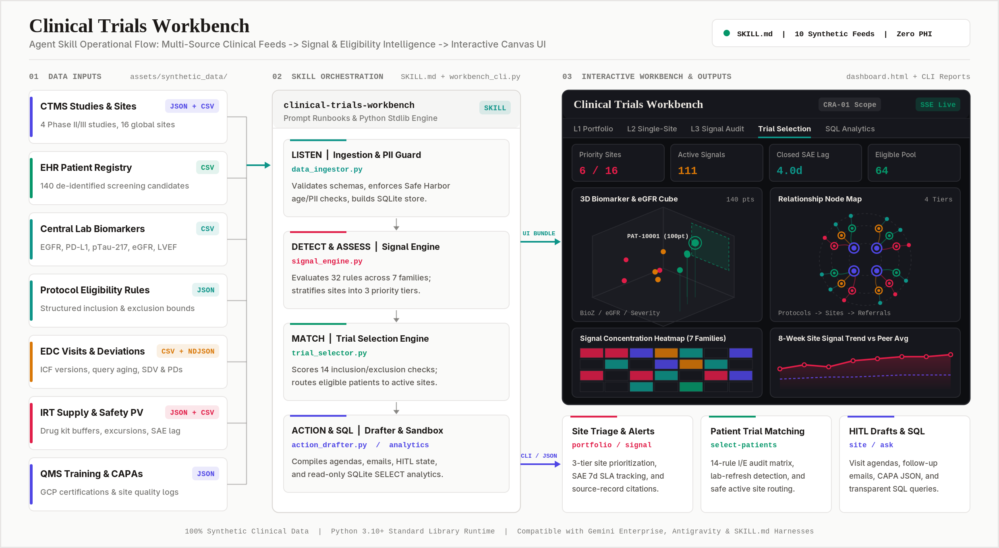

# Clinical Trials Workbench Skill

## 1. Overview

The **Clinical Trials Workbench** (`clinical-trials-workbench`) is an AI Agent Skill compatible with standardized `SKILL.md` / Skill Plug-in harnesses and standalone terminal execution.



Pharmaceutical and clinical research organizations frequently manage clinical trials across 15 or more disconnected systems of record, creating manual data reconciliation bottlenecks, delayed safety and compliance risk detection, and slow candidate patient screening. This skill layers an analytical and visual decision workbench directly over multi-source clinical feeds without modifying underlying systems of record:

- **Multi-Source Synthetic Data Ecosystem:** Models 10 deterministic, 100% synthetic, HIPAA Safe Harbor-compliant data feeds (`.csv`, `.json`, and `.ndjson`) spanning CTMS, Protocol Eligibility Registries, EHR Pre-Screening Pools, Central Laboratory Biomarkers, EDC Visits, EDC Protocol Deviations, IRT Drug Supply, Pharmacovigilance/Safety, and QMS/LMS Training.
- **Clinical Trial Patient Selection Engine:** Evaluates 140 synthetic candidate patients across 4 Phase II/III trials (Oncology NSCLC, Heart Failure, Prodromal Neurodegeneration, and Autoimmune IBD) with criterion-by-criterion Inclusion/Exclusion audit trails, separating immediately `ELIGIBLE` candidates from `POTENTIAL_NEEDS_LABS` refresh candidates and routing them only to active, supply-ready clinical sites.
- **Listen -> Detect -> Assess -> Action Risk Pipeline:** Evaluates 32 declarative rules across 7 signal families (`SAFETY`, `INFORMED_CONSENT`, `TRAINING_COMPLIANCE`, `DATA_QUALITY_EDC`, `ENROLLMENT_RETENTION`, `SUPPLY_IRT`, `PROTOCOL_COMPLIANCE`), stratifies 16 global clinical sites into 3 operational priority tiers, tracks Serious Adverse Event (SAE) reporting cycle times against a 7-day target (vs. a 28-day manual baseline), and drafts monitoring visit agendas, follow-up emails, and CAPA payloads with atomic human-in-the-loop feedback persistence.
- **Standalone Interactive 2D/3D Workbench (`dashboard.html`):** Emits a self-contained visual interface conforming to `DESIGN.md` with self-hosted WOFF2 typography, WCAG 2.2 AA contrast and keyboard navigation, Light/Dark/System OS themes, Cross-Site Signal Heatmaps, SAE Cycle-Time Trend Plots, an Interactive Relationship Node Map, a 3D Biomarker and Organ-Function Projection, and Transparent NL-to-SQL Analytics.

### Repository Layout

```text
clinical-trials-workbench-skill/
|-- DESIGN.md                                  # Visual and technical UI design specification
|-- LICENSE                                    # Apache License, Version 2.0
|-- README.md                                  # Setup, CLI execution, and end-user guide
|-- SECURITY_AUDIT.md                          # Security, privacy, accessibility, and hygiene audit log
|-- SKILL.md                                   # Primary Agent Skill instructions and operational runbooks
|-- dashboard.html                             # Generated standalone interactive workbench
|-- requirements.txt                           # Python test dependency specification
|-- assets/
|   |-- fonts/                                 # Self-hosted SIL OFL 1.1 WOFF2 fonts and license attribution
|   |-- images/
|   |   `-- clinical_trials_workbench_overview.png
|   |-- schemas/
|   |   |-- signal_rules_config.json           # Declarative 32-rule signal thresholds
|   |   `-- workspace_bundle_schema.json       # Workspace bundle JSON Schema
|   |-- synthetic_data/
|   |   |-- ctms_sites.csv
|   |   |-- ctms_studies.json
|   |   |-- edc_protocol_deviations.ndjson
|   |   |-- edc_subject_visits.csv
|   |   |-- ehr_patients.csv
|   |   |-- irt_randomization_inventory.json
|   |   |-- lab_biomarkers.csv
|   |   |-- qms_training_issues.json
|   |   |-- safety_sae_events.csv
|   |   `-- trial_eligibility_criteria.json
|   `-- templates/
|       |-- issue_capa_record.json.tpl
|       |-- monitoring_visit_agenda.md.tpl
|       `-- site_followup_email.txt.tpl
|-- documents/
|   `-- prd.md                                 # Product Requirement Document (PRD)
|-- legal/
|   |-- cookies.md                             # Draft cookie and local storage notice (requires legal review)
|   |-- privacy.md                             # Draft privacy notice (requires legal review)
|   |-- refunds.md                             # Draft refund policy (requires legal review)
|   `-- terms.md                               # Draft terms of service (requires legal review)
|-- references/
|   |-- clinical_ontology_and_signals.md       # Semantic domain ontology and 32-signal catalog
|   |-- data_dictionary.md                     # Field-level schemas across all 10 synthetic feeds
|   `-- eligibility_criteria_guide.md          # Trial eligibility scoring and site placement rules
|-- scripts/
|   |-- __init__.py                            # Relative path resolution, logging, and domain exceptions
|   |-- action_drafter.py                      # Briefings, agendas, emails, HITL persistence, data export/erasure
|   |-- analytics_assistant.py                 # NL-to-SQL engine and hardened read-only SQLite sandbox
|   |-- build_dashboard.py                     # Standalone HTML/2D/3D workbench builder
|   |-- data_ingestor.py                       # Multi-source ingestion, PII Safe Harbor scanner, SQLite builder
|   |-- generate_synthetic_data.py             # Deterministic 10-feed synthetic clinical data generator
|   |-- signal_engine.py                       # 32-rule risk signal engine and 3-tier site classification
|   |-- trial_selector.py                      # Patient inclusion/exclusion engine and site placement ranker
|   `-- workbench_cli.py                       # Unified CLI orchestrator and hardened HTTP/SSE server
`-- tests/
    |-- __init__.py
    |-- test_smoke.py                          # Repository structure, SKILL.md, PRD, and CLI smoke tests
    |-- test_system_e2e.py                     # End-to-end CLI, dashboard, HTTP/SSE, security, and hygiene tests
    `-- test_unit_core.py                      # Unit tests for PII scanner, ingestion, signals, SQL, and state
```

---

## 2. Prerequisites

- **Operating System:** Linux, macOS, or Windows.
- **Python Runtime:** Python `3.10` or newer (tested on Python `3.13`). Core skill scripts rely solely on the Python standard library (`sqlite3`, `csv`, `json`, `http.server`, `argparse`, `dataclasses`, `pathlib`, `logging`, `hmac`, `tempfile`) for zero-install execution inside restricted runtime sandboxes.
- **Browser (Optional for Visual UI):** Any modern Chromium, Firefox, or WebKit browser to inspect `dashboard.html`. All typography is self-hosted under `assets/fonts/` with zero external network calls.

### Virtual Environment Setup

```bash
python3 -m venv .venv
source .venv/bin/activate
pip install -r requirements.txt
```

---

## 3. Local Execution

Run all commands from the project root directory.

### 3.1 Generate Multi-Source Synthetic Clinical Data
Regenerate all 10 deterministic synthetic feeds under `assets/synthetic_data/`:

```bash
python3 scripts/workbench_cli.py generate-data --seed 42
```

### 3.2 Run Clinical Operations and Trial Selection CLI Workflows

```bash
# 1. Level 1 Portfolio Triage (Global or scoped to CRA-01..CRA-04)
python3 scripts/workbench_cli.py portfolio --cra ALL
python3 scripts/workbench_cli.py portfolio --cra CRA-01 --tier "Priority Action Required"

# 2. Clinical Trial Patient Selection & Site Matching
python3 scripts/workbench_cli.py select-patients --study-id NCT-SYN-0101 --status ELIGIBLE
python3 scripts/workbench_cli.py select-patients --patient-id PAT-10001

# 3. Level 2 Single-Site Review, Monitoring Agenda, and Follow-Up Email Draft
python3 scripts/workbench_cli.py site --site-id SITE-101 --draft-agenda --draft-email

# 4. Level 3 Signal Audit, Issue Export, and Human-in-the-Loop Feedback
python3 scripts/workbench_cli.py signal --signal-id SIG-1001 --draft-issue
python3 scripts/workbench_cli.py signal --signal-id SIG-1001 --feedback ACCEPT --note "Confirmed safety narrative call"

# 5. Transparent Conversational Analytics & Guarded Read-Only SQL
python3 scripts/workbench_cli.py ask --question "Compare SAE follow-up reporting cycle times across studies"
python3 scripts/workbench_cli.py ask --sql "SELECT protocol_code, COUNT(*) AS eligible FROM eligibility_assessments WHERE classification = 'ELIGIBLE' GROUP BY protocol_code"
```

### 3.3 Build and Launch the Interactive 2D/3D Workbench

```bash
# Emit standalone offline-capable dashboard.html at the project root
python3 scripts/workbench_cli.py build-dashboard --output dashboard.html

# Optional: Serve over loopback HTTP with live Server-Sent Events (SSE) on http://127.0.0.1:8765
python3 scripts/workbench_cli.py serve --host 127.0.0.1 --port 8765
```

#### Local Server Security and Privacy Environment Variables
- `CTW_DATA_DIR`: Relative or custom path to the 10-feed clinical dataset directory (default: `assets/synthetic_data`).
- `CTW_STATE_FILE`: Path to persisted reviewer feedback JSON file (default: `assets/workbench_feedback_state.json`).
- `CTW_API_TOKEN`: Optional Bearer token enforced via constant-time verification on `/api/*` and `/events`. Required automatically if `--host` is set to a non-loopback address and always required for `/api/user-data/export` and `/api/user-data/delete`.
- `CTW_AUTHENTICATED_REVIEWER`: Optional server-pinned reviewer ID enforced against owner-scoped data portability and erasure requests.

Draft legal policy pages are served locally at `/privacy`, `/terms`, `/refunds`, and `/cookies` from `legal/*.md` (`DRAFT — REQUIRES LEGAL REVIEW`).

### 3.4 Execute the Automated CLI Test Suite
Run unit, smoke, security, accessibility, and end-to-end tests from the project root using either `pytest` or Python's built-in `unittest` runner:

```bash
pytest -v
python3 -m unittest discover -s tests -v
```

Both commands return exit code `0` when all functional, visual, security, accessibility, and privacy checks pass.

---

## 4. Harness Usage (Non-Technical End-User Guide)

### Step 1: Load the Skill into Your Agent Harness
1. **Skill Installation:** Place or symlink the `clinical-trials-workbench-skill` directory inside your workspace `skills/` folder (for example, `<workspace>/skills/clinical-trials-workbench/` or `<workspace>/.agents/skills/clinical-trials-workbench/`).
2. **Automatic Discovery:** The harness reads the YAML frontmatter in `SKILL.md` (`name: clinical-trials-workbench`) and activates the skill automatically whenever you ask about clinical trials, patient screening, site monitoring signals, or interactive trial dashboards.

### Step 2: Sample End-User Prompts and Expected Outputs

#### Scenario 1: Morning Portfolio Triage for a Site Monitor
- **User Prompt:**
  > "Give me a morning briefing for CRA-01 including peer coverage sites. Which clinical sites require priority action right now, and how are our SAE reporting cycle times tracking against the 7-day goal?"
- **What Happens Behind the Scenes:** The agent runs `python3 scripts/workbench_cli.py portfolio --cra CRA-01` and inspects the 3-tier site output.
- **Expected Output:** A concise executive summary reporting which assigned sites fall into *Priority Action Required* (such as `SITE-101`, `SITE-105`, `SITE-113`), citing specific CRITICAL signals (delayed SAE reporting, outdated Informed Consent versions, or cold-chain excursions), and comparing median closed SAE turnaround (4.0 days) against the 7-day target and 28-day legacy baseline.

#### Scenario 2: Screening Synthetic Patients for an Oncology Trial
- **User Prompt:**
  > "Find all eligible synthetic patients for the NSCLC trial ONCO-301 (NCT-SYN-0101), and also list North American patients who only need a lab refresh before they can be referred."
- **What Happens Behind the Scenes:** The agent runs `select-patients --study-id NCT-SYN-0101 --status ELIGIBLE` and `select-patients --study-id NCT-SYN-0101 --status POTENTIAL_NEEDS_LABS --region NA`.
- **Expected Output:** A structured candidate table listing synthetic IDs (for example, `PAT-10001` through `PAT-10035`), EGFR/PD-L1 biomarker findings, match scores, missing/stale lab assays to order, and the highest-ranked active clinical site for referral.

#### Scenario 3: Preparing a Site Monitoring Visit Agenda and Email
- **User Prompt:**
  > "Prepare a monitoring visit agenda and follow-up email draft for SITE-101 covering its active safety and informed consent signals."
- **What Happens Behind the Scenes:** The agent runs `python3 scripts/workbench_cli.py site --site-id SITE-101 --draft-agenda --draft-email`.
- **Expected Output:** A formatted Markdown Monitoring Visit Agenda citing exact source files and record IDs (`SAE-3001`, `VIS-7001`, `PD-9001`) plus a copy-ready follow-up email addressed to synthetic `.example` institutional roles.

#### Scenario 4: Interactive Visual Workbench Inspection
- **User Prompt:**
  > "Build the interactive clinical trials workbench dashboard so I can explore the 3D biomarker plot, cross-site signal heatmap, and relationship node map."
- **What Happens Behind the Scenes:** The agent executes `python3 scripts/workbench_cli.py build-dashboard --output dashboard.html`.
- **Expected Output:** Confirmation that `dashboard.html` has been compiled at the project root with instructions to open `dashboard.html` directly in a browser (with zero external network dependencies) or launch live SSE mode.

---

## 5. License

This project is licensed under the Apache License, Version 2.0. See the [LICENSE](LICENSE) file for the full license text and terms. Self-hosted WOFF2 fonts in `assets/fonts/` are licensed under the SIL Open Font License 1.1 (`assets/fonts/LICENSES.txt`).
